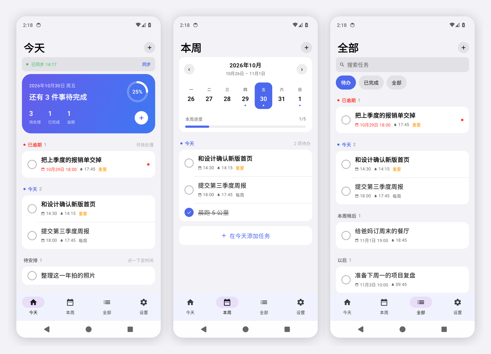
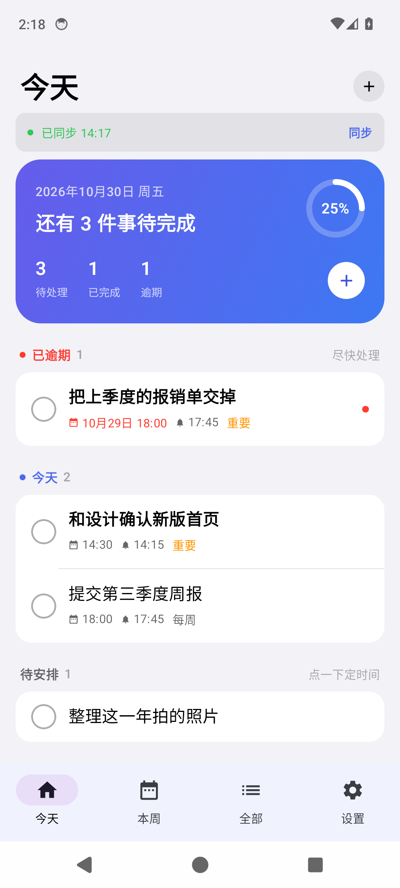
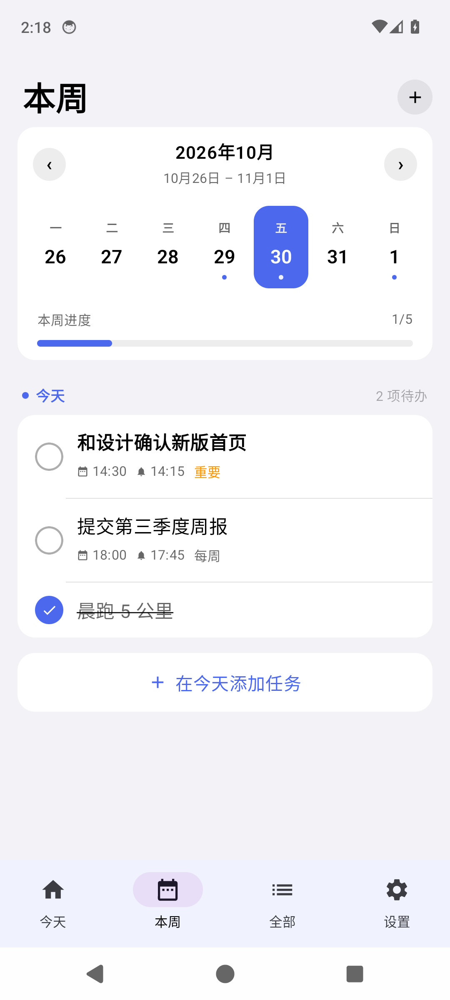
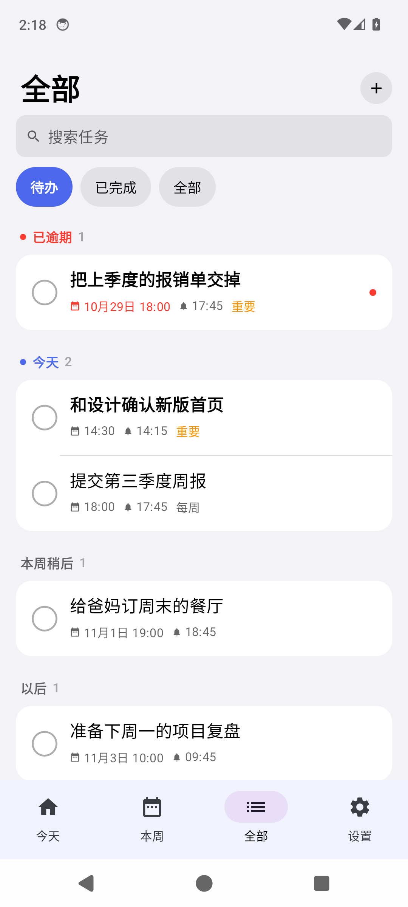
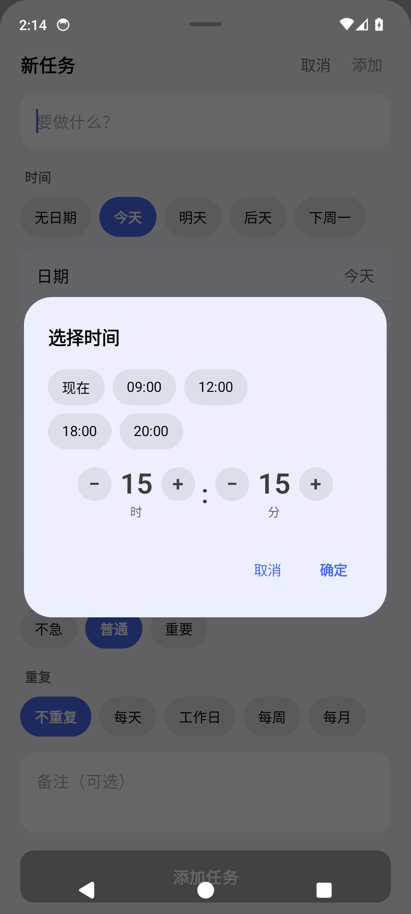
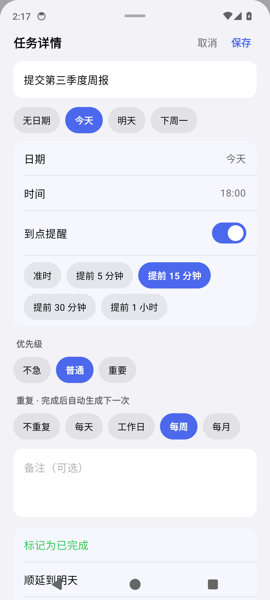
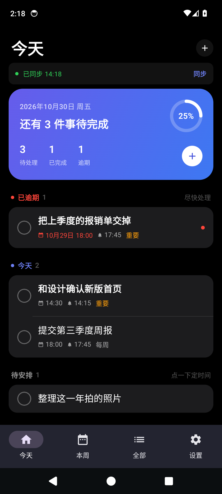
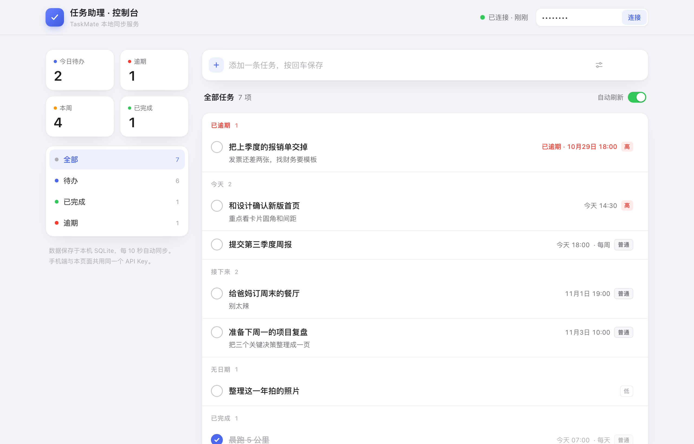
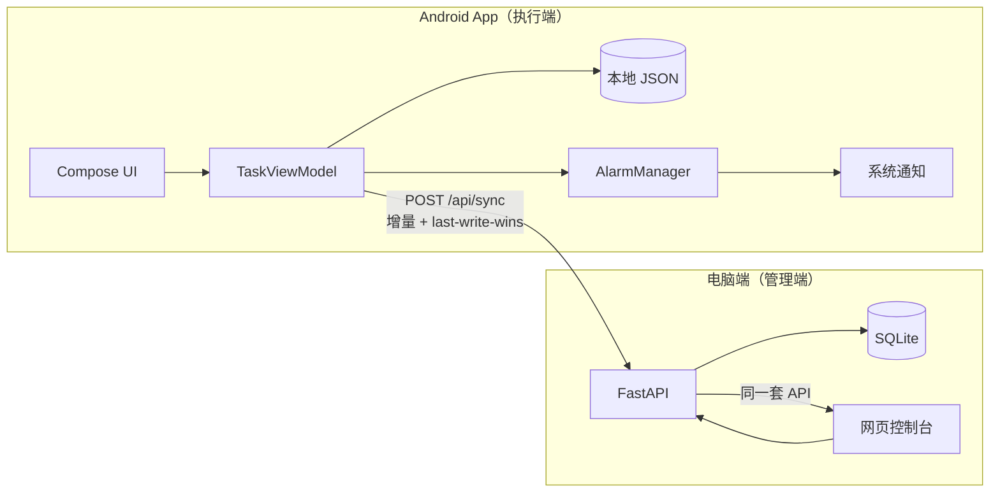

# 任务助理 · TaskMate

**一个只给自己用的任务助理**：打开就知道今天该干什么，到点会提醒，电脑上还能看到全部任务。
原生 Android（Kotlin + Jetpack Compose），本地优先，不依赖任何云服务。


[](https://github.com/cangyuyi/taskmate/actions/workflows/ci.yml)



---

## 为什么做这个

市面上的待办 App 要么太复杂（项目、看板、协作），要么把数据放在别人服务器上。
我想要的只有三件事：

1. **打开三秒内知道该做什么** —— 今天页只有“逾期 / 今天 / 待安排”
2. **到点一定响** —— 系统级精确闹钟，不靠推送、不靠后台进程
3. **电脑上能管** —— 大屏上规划，手机上执行

所以它是一个“单人、本地、可自己改”的项目：APK 自己签、数据在自己电脑上、代码全在这里。

---

## 功能

**记录**

- 快速添加：标题 → 时间 → 保存，默认就停在下个 5 分钟整点
- 内置时间选择器（不依赖系统弹窗，任何 ROM 表现一致）+ 快捷时刻
- 优先级（不急 / 普通 / 重要）、备注
- 语音/文字随手记的“待安排”：没定日期的任务也不会消失

**组织**

- **今天**：完成度环、逾期置顶、待安排、已完成折叠
- **本周**：周一到周日日期条、切周、按天查
- **全部**：逾期 / 今天 / 本周稍后 / 以后 / 没有日期 / 已完成，支持搜索与筛选
- **重复任务**：每天 / 工作日 / 每周 / 每月，完成即自动生成下一次

**提醒**

- `AlarmManager` 精确闹钟：App 被杀、手机重启后依然准时
- 通知上直接「完成」或「10 分钟后」，不用打开 App
- 点通知直达任务详情
- 自检：设置里显示「精确提醒」真实状态，可发测试通知 / 60 秒后测试提醒

**电脑端**

- 浏览器控制台：统计、筛选、改标题改时间、勾完成、删除、回车新增
- 双向同步：手机改动 0.9 秒内推送，电脑改动手机回前台自动拉取
- 开机自启（launchd），崩溃自动拉起

**数据**

- 本地优先：断网、电脑关机都不影响使用
- 一键导出 JSON 备份
- 删除可撤销；删除是软删除，多设备之间不会“复活”

---

## 截图

| 今天 | 本周 | 全部 |
| --- | --- | --- |
|  |  |  |

| 快速添加 | 任务详情 | 深色模式 |
| --- | --- | --- |
|  |  |  |

**电脑端控制台**



---

## 架构



- 手机是**执行端**：增删改、排期、弹通知全部本地完成，断网也能用
- 电脑是**管理端**：汇总展示 + 直接修改，改动通过增量同步回到手机
- 没有云端，没有账号体系，只有一把局域网内使用的 API Key

细节见 [docs/架构说明.md](docs/架构说明.md)。

---

## 快速开始

### 直接装（推荐）

到 [Releases](https://github.com/cangyuyi/taskmate/releases) 下载最新的 `TaskMate-x.y.apk`，传到手机安装。

### 自己构建

```bash
bash scripts/setup-toolchain.sh   # 首次：JDK 17 + Android SDK + Gradle（约 1.2 GB，装在 .toolchain/）
bash scripts/build-apk.sh         # 产物：dist/TaskMate-x.y.apk（自动签名并校验）
```

没有 `keystore.properties` 时会产出**未签名**的 release 包，不影响调试与 CI。
想自己签名：`cp keystore.properties.example keystore.properties` 后填密码。

### 跑电脑端

```bash
cd server
python3 -m venv .venv && .venv/bin/pip install -r requirements.txt
.venv/bin/python main.py
```

浏览器打开 `http://127.0.0.1:8788/?key=<启动日志里的 API Key>`。
手机端在「设置 → 电脑端同步」填入 `http://<电脑局域网IP>:8788` 和同一个 Key。

---

## 项目结构

```
.
├── app/                        # Android 应用（Kotlin + Compose）
│   ├── src/main/java/com/edy/taskmate/
│   │   ├── data/               # Task 模型、重复规则、纯函数操作、本地存储、同步客户端
│   │   ├── alarm/              # 精确闹钟、通知、通知按钮、桌面小组件、开机重排
│   │   └── ui/                 # 主题、组件、四个页面、两个弹层
│   └── src/test/               # JVM 单元测试（重复规则 / 操作语义）
├── server/                     # 电脑端：FastAPI + SQLite + 控制台网页
│   ├── app.py service.py store.py config.py
│   ├── static/index.html       # 自包含控制台，无外链
│   └── tests/                  # 41 个 unittest
├── scripts/                    # 工具链安装 / 打包 / 局域网分发 / 开机自启
├── docs/                       # 使用手册、架构说明
├── preview/                    # 截图
└── .github/workflows/ci.yml    # 两端构建与测试
```

---

## 技术栈

| 层 | 选型 | 说明 |
| --- | --- | --- |
| UI | Jetpack Compose + Material 3 | 自定义 iOS 风格组件，深浅色自适应 |
| 状态 | ViewModel + StateFlow/Compose State | 单 Activity，四个 Compose 页面 |
| 存储 | JSON 文件（`TaskStore`） | 个人规模够用，便于导出与排查 |
| 提醒 | `AlarmManager` + `NotificationCompat` | 精确闹钟，不依赖长连接与推送服务 |
| 桌面 | `RemoteViews` 小组件 | 今天剩余数 + 前三条 |
| 电脑端 | FastAPI + SQLite + 原生 JS | 控制台单文件、零构建、零 CDN |
| 同步 | HTTP + JSON，LWW + 软删除墓碑 | 简单、可预期、易调试 |

---

## 隐私与安全

- 任务数据**只存在手机和你的电脑**，不上传任何第三方
- 电脑端仅监听局域网，**不要做公网端口映射**
- `server/.env`、`keystore.properties`、`*.jks` 都在 `.gitignore` 中，不会进仓库
- API Key 默认由服务端随机生成；也可以用 `.env` 固定下来

---

## 开发

```bash
./gradlew :app:testReleaseUnitTest   # Android 单元测试
cd server && python -m unittest discover -s tests   # 电脑端测试
```

新增字段要改哪些地方，见 [docs/架构说明.md](docs/架构说明.md#6-新增字段要改哪些地方)。

---

## 路线图

- [x] 今天 / 本周 / 全部、快速添加、任务详情
- [x] 精确提醒、通知操作、桌面小组件
- [x] 重复任务、待安排、删除撤销、备份导出
- [x] 电脑端控制台 + 双向同步 + 开机自启
- [ ] 每日 / 每周回顾
- [ ] 自然语言添加（“明天下午三点交周报”）
- [ ] 标签与统计热力图
- [ ] 后台定时同步（WorkManager）
- [ ] 备份导入

---

## License

[MIT](LICENSE) © 2026 cangyuyi
